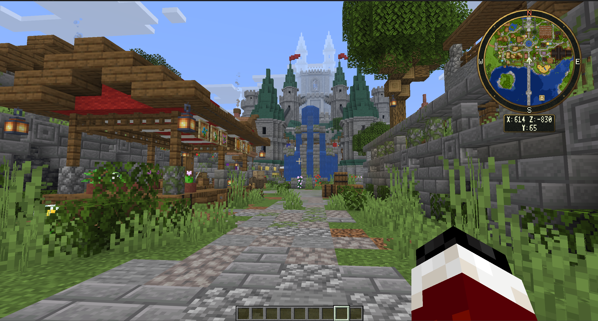

# BeastMiniMap

A corner minimap and interactive fullscreen atlas for Minecraft servers. Explore terrain, find public places and save personal waypoints without installing a client mod.

Start with [First Install](docs/gitbook/getting-started/first-install.md), or open the [user guide](docs/gitbook/README.md) for map controls, settings, permissions and server setup.



## Features

- Corner minimap and draggable fullscreen or framed atlas.
- Live surface terrain, optional cave layers and saved world-image maps.
- Personal exploration and waypoints, plus administrator-managed public places.
- Configurable zoom, minimap shapes/corners, markers and coordinate panels.
- Per-player settings, configurable opening shortcuts and seven coordinated themes.
- Individual button/settings permissions and personal waypoint limits per role.
- 33 bundled languages, with 17 optional language downloads.
- SQLite storage by default, with optional MySQL.

## Requirements

Paper or Spigot **1.21.9 through 26.3**, plus [BeastLib **1.7.3 or newer**](https://modrinth.com/plugin/beastlib). Use Java 21 or newer for supported 1.21.x servers; Minecraft 26.x servers require Java 25 or newer. Players must accept the matching server resource pack.

## Complete packs

Download the complete packs from [resource-pack releases](https://github.com/MrAxeTv/BeastMiniMap/releases/tag/packs-1.0-r3). Choose a pack for each client version your server accepts. Download checksums are available in [SHA256SUMS.txt](https://github.com/MrAxeTv/BeastMiniMap/releases/download/packs-1.0-r3/SHA256SUMS.txt).

| Minecraft client | Download | Use |
| --- | --- | --- |
| 1.21.9 and 1.21.10 | [BeastMiniMap-1.21.9.zip](https://github.com/MrAxeTv/BeastMiniMap/releases/download/packs-1.0-r3/BeastMiniMap-1.21.9.zip) | Install for these clients |
| 1.21.11 | [BeastMiniMap-1.21.11.zip](https://github.com/MrAxeTv/BeastMiniMap/releases/download/packs-1.0-r3/BeastMiniMap-1.21.11.zip) | Install for these clients |
| 26.1, 26.1.1 and 26.1.2 | [BeastMiniMap-26.1.zip](https://github.com/MrAxeTv/BeastMiniMap/releases/download/packs-1.0-r3/BeastMiniMap-26.1.zip) | Install for these clients |
| 26.2 | [BeastMiniMap-26.2.zip](https://github.com/MrAxeTv/BeastMiniMap/releases/download/packs-1.0-r3/BeastMiniMap-26.2.zip) | Install for these clients |
| 26.3 | [BeastMiniMap-26.3.zip](https://github.com/MrAxeTv/BeastMiniMap/releases/download/packs-1.0-r3/BeastMiniMap-26.3.zip) | Install for these clients |

Each complete ZIP includes all seven built-in themes. Put it unchanged in `plugins/BeastMiniMap/Packs/`. Resource packs are downloaded separately from the plugin JAR; the plugin does not fetch these ZIPs automatically.

## Installation

1. Install `BeastMiniMap.jar` and the normal `BeastLib.jar` runtime in the server's `plugins` folder.
2. Create `plugins/BeastMiniMap/Packs/` and add the complete ZIPs for the client versions you support. Keep their original filenames and leave the archives intact.
3. Start or restart the server normally.
4. Configure the pack download address in `config.yml`. Use the [hosting guide](docs/gitbook/resource-packs/hosting.md), then check `/beastminimap pack info` to confirm that players can reach the advertised URL.
5. Grant your player roles the desired [map permissions](#permissions) and waypoint allowance.
6. Join, accept the offered resource pack and open `/beastminimap`. Use `/beastminimap map settings` to personalize the maps.

Use `/beastminimap reload` after configuration or pack-only changes. Install new plugin JARs with a normal server restart. [Follow the full setup checklist](docs/gitbook/getting-started/common-setup-flow.md).

Without a pack installed, administrative commands remain available and the plugin reports the missing file with the GitHub download link. Install the matching ZIP and reload to enable its maps. A missing or invalid version's pack leaves other installed versions available.

If you host downloads externally, upload the **prepared** ZIP from `plugins/BeastMiniMap/Packs/Prepared/` and use the corresponding URL/hash reported by `/beastminimap pack info`. See [pack hosting](docs/gitbook/resource-packs/hosting.md) for built-in HTTP hosting, external hosting and connection checks.

## Editable theme examples

All seven presets are included in each complete client-version ZIP. The seven editable downloads below are **optional starting points for custom artwork**, not additional files required to select a built-in preset.

| Theme | Editable example |
| --- | --- |
| Cartographer (default) | [Download](https://github.com/MrAxeTv/BeastMiniMap/releases/download/packs-1.0-r3/BeastMiniMap-Theme-Cartographer-1.0.zip) |
| Futuristic | [Download](https://github.com/MrAxeTv/BeastMiniMap/releases/download/packs-1.0-r3/BeastMiniMap-Theme-Futuristic-1.0.zip) |
| Vanilla | [Download](https://github.com/MrAxeTv/BeastMiniMap/releases/download/packs-1.0-r3/BeastMiniMap-Theme-Vanilla-1.0.zip) |
| Medieval | [Download](https://github.com/MrAxeTv/BeastMiniMap/releases/download/packs-1.0-r3/BeastMiniMap-Theme-Medieval-1.0.zip) |
| Minimal Dark | [Download](https://github.com/MrAxeTv/BeastMiniMap/releases/download/packs-1.0-r3/BeastMiniMap-Theme-MinimalDark-1.0.zip) |
| Cartoony | [Download](https://github.com/MrAxeTv/BeastMiniMap/releases/download/packs-1.0-r3/BeastMiniMap-Theme-Cartoony-1.0.zip) |
| Oceanic | [Download](https://github.com/MrAxeTv/BeastMiniMap/releases/download/packs-1.0-r3/BeastMiniMap-Theme-Oceanic-1.0.zip) |

Extract an example into `plugins/BeastMiniMap/Themes/`. It creates `Themes/<Preset>Editable/Theme.yml` and `Artwork/` under the plugin's data folder, with a unique ID such as `medieval_editable`, the matching built-in `BasedOn` palette, and **`Enabled: false`**. Edit its PNGs and settings, then set `Enabled: true`, reload and accept the updated pack. Preserve image paths/dimensions and the theme's ID once players use it. Up to eight enabled custom themes can join the shared pack.

Players preview and Apply installed themes in Map Settings without another pack download. Adding or editing artwork changes the pack and requires renewed acceptance.

See [themes and custom artwork](docs/gitbook/customization/themes.md) for the complete setup and editing instructions.

## Useful commands

| Command | Purpose |
| --- | --- |
| `/beastminimap` | Open fullscreen map; configurable to show help instead |
| `/beastminimap help` | Show commands |
| `/beastminimap on` / `/beastminimap off` | Show or hide the minimap |
| `/beastminimap map settings` | Open personal map settings |
| `/beastminimap keybind` | Inspect or customize the map shortcut |
| `/beastminimap pack` / `/beastminimap pack info` | Request a pack or inspect delivery |
| `/beastminimap theme list` / `/beastminimap theme set <id>` | Inspect themes or select the server default; administrator |
| `/beastminimap reload` | Reload settings; administrator |

`/beastminimap` is permanent. Default configurable aliases are `/minimap`, `/bmm` and `/map`; another plugin may own an alias.

## Permissions

Ordinary players require explicit action grants by default; operators inherit all declared permissions. Give roles the two control groups below, or grant individual actions. Commands, shortcuts, pixel menus and native dialogs use the same checks. Explicit false child permissions override broader wildcard grants.

| Permission | Access |
| --- | --- |
| `beastminimap.use` | Basic player commands; enabled by default |
| `beastminimap.buttons.*` | All map buttons, including opening the atlas |
| `beastminimap.buttons.zoom.in` | Atlas zoom-in action only |
| `beastminimap.settings.*` | All player settings |
| `beastminimap.settings.minimap.shape` | Minimap shape setting only |
| `beastminimap.waypoints.limit.N` | Personal waypoint allowance; highest true numeric grant wins |
| `beastminimap.waypoints.limit.unlimited` | Unlimited personal waypoints |
| `beastminimap.admin` | Server controls; operator default |
| `beastminimap.places.admin` | Shared-place editing; operator default |

Waypoint limits count all of a player's worlds. Zero blocks new waypoints; lowering a limit preserves existing records. Without a numeric or unlimited grant, `Atlas.WaypointsPerPlayer` applies (default 64). The button/settings groups do not grant unlimited waypoints, and quota grants do not unlock creation actions.

For example, with LuckPerms:

```text
/lp group default permission set beastminimap.buttons.* true
/lp group default permission set beastminimap.settings.* true
/lp group default permission set beastminimap.waypoints.limit.16 true
```

`Permissions.RequireExplicitGrants: false` permits unassigned controls while honoring explicit denials. Denied actions show the editable language message and play a configurable villager rejection sound, with a feedback cooldown. Back/cancel, the recovery key and `/beastminimap map close` remain available after access changes.

See the [complete permissions guide](docs/permissions.md) for every action, wildcard group, quota rule and configuration option.

## More setup guides

- [Map controls and navigation](docs/gitbook/maps/atlas.md)
- [Personal waypoints and public places](docs/gitbook/maps/waypoints-and-places.md)
- [Cave layers](docs/gitbook/terrain/live-and-caves.md)
- [Rendering a saved world image](docs/gitbook/terrain/world-images.md)
- [SQLite, MySQL and backups](docs/gitbook/storage.md)
- [Troubleshooting](docs/gitbook/troubleshooting/common-issues.md)

<!-- BEGIN BEASTMINIMAP LANGUAGES -->
## Languages

English (`en-US.yml`) is the default. The plugin bundles 33 European/US-English
language files, including Russian and Turkish. The remaining 17 files are
available in the [matching language snapshot](https://github.com/MrAxeTv/BeastMiniMap/tree/languages-502f0eddb9c0c115/languages).

Selecting an optional filename downloads its matching defaults in the background
when `Options.Language.Settings.AutoDownload: true` (the default). Set it to
`false` to use manual installation. English remains available offline.

For manual installation, download the YAML into `plugins/BeastMiniMap/Lang/`,
select its exact filename with `Options.Language.Settings.File` in `config.yml`,
then run `/beastminimap reload` or restart normally. Existing local edits are
preserved. See [language downloads and checksums](languages/README.md).

Translations are machine-assisted. Use `Atlas.MenuUi: native` for scripts the
compact bitmap font cannot display; retain Latin text for the atlas header.
<!-- END BEASTMINIMAP LANGUAGES -->
