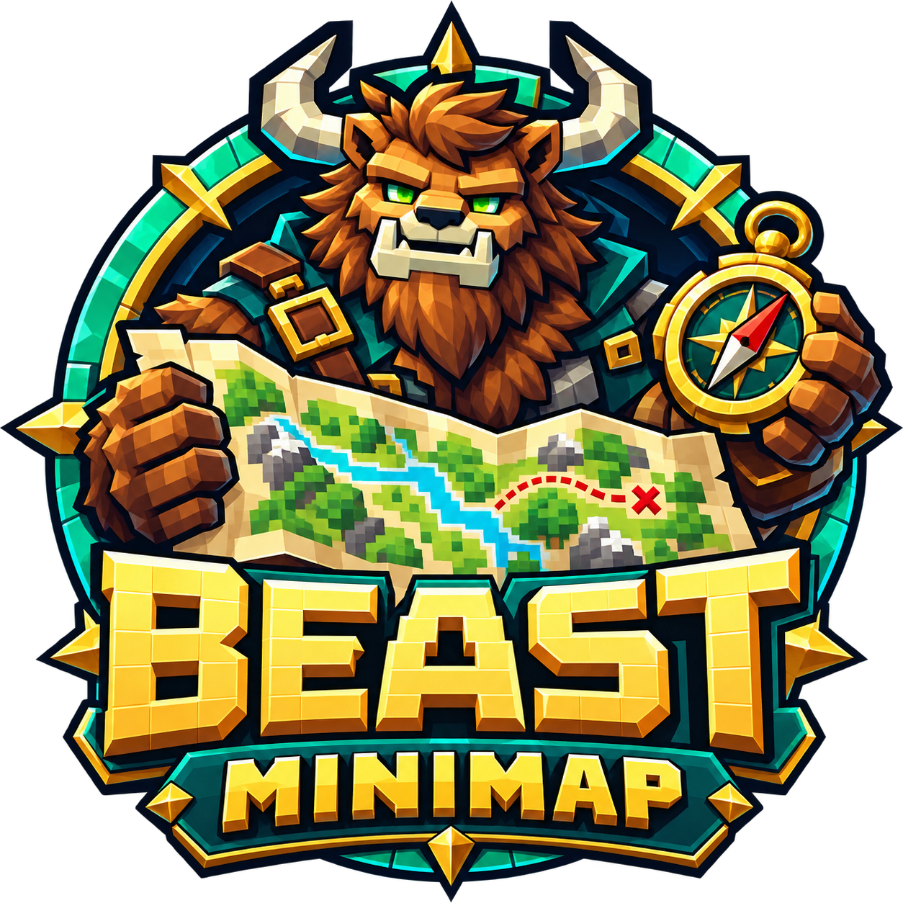
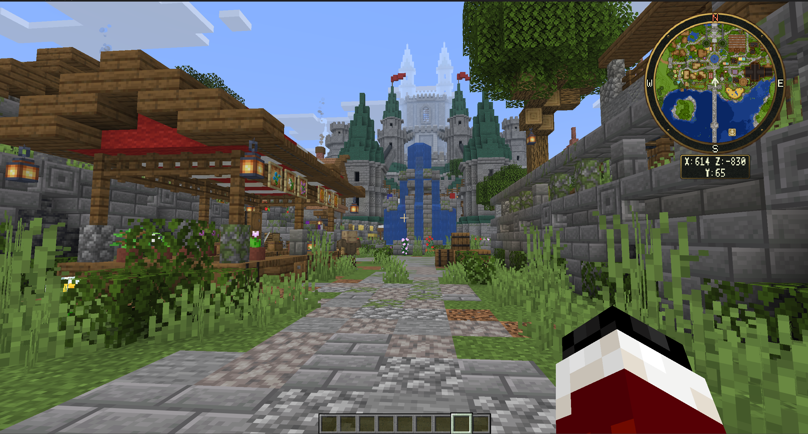

# BeastMiniMap Wiki

BeastMiniMap gives Minecraft players a corner minimap, an interactive fullscreen or framed atlas, personal waypoints, and shared server places. Players use the server's resource pack; no client mod is required.

This guide is written for server owners and players. Start with installation, then choose permissions, terrain sources, and the player options your server allows.

## Start here

1. [Install the plugin and BeastLib](getting-started/first-install.md).
2. [Install the matching complete resource packs](resource-packs/installation.md).
3. [Make the download address reachable](resource-packs/hosting.md).
4. [Grant map controls and waypoint limits](permissions.md).
5. [Open the map and explore](maps/atlas.md).

## Find an instruction

| I want to… | Guide |
| --- | --- |
| Set up a new server | [Common setup flow](getting-started/common-setup-flow.md) |
| Find a configuration file or apply changes | [Plugin configuration](getting-started/configuration.md) |
| Change the minimap's shape, corner, or zoom | [Minimap](maps/minimap.md) |
| Pan, search, or return to my location | [Atlas](maps/atlas.md) |
| Save a base or publish a server landmark | [Waypoints and places](maps/waypoints-and-places.md) |
| Give a rank more waypoints | [Permissions and waypoint limits](permissions.md) |
| Change player icons or map settings | [Player settings](customization/player-settings.md) |
| Set an opening shortcut | [Keybinds](customization/keybinds.md) |
| Change themes or edit artwork | [Themes](customization/themes.md) |
| Translate messages or the atlas title | [Languages](customization/languages.md) |
| Enable cave layers | [Live terrain and caves](terrain/live-and-caves.md) |
| Render a saved image around my position | [Saved world images](terrain/world-images.md) |
| Configure SQLite or MySQL | [Storage](storage.md) |
| Diagnose a missing map or pack | [Common issues](troubleshooting/common-issues.md) |

## Supported setup

Use Paper or Spigot **1.21.9 through 26.3**, with [BeastLib 1.7.3 or newer](https://modrinth.com/plugin/beastlib). The plugin uses Java 21 bytecode; Minecraft 26.x servers require Java 25 or newer. Install the complete pack matching each client version your server accepts.

The plugin JAR contains no resource-pack ZIPs or artwork images. Download complete packs from the [official public releases](https://github.com/MrAxeTv/BeastMiniMap/releases). Each complete client-version pack includes all seven built-in themes.

## Need help?

Check [Common Issues](troubleshooting/common-issues.md) for problems with opening the map, accepting the resource pack, permissions, or saved settings. Use the [player command reference](commands/player-commands.md) for map controls and the [administrator command reference](commands/admin-commands.md) for server setup.
