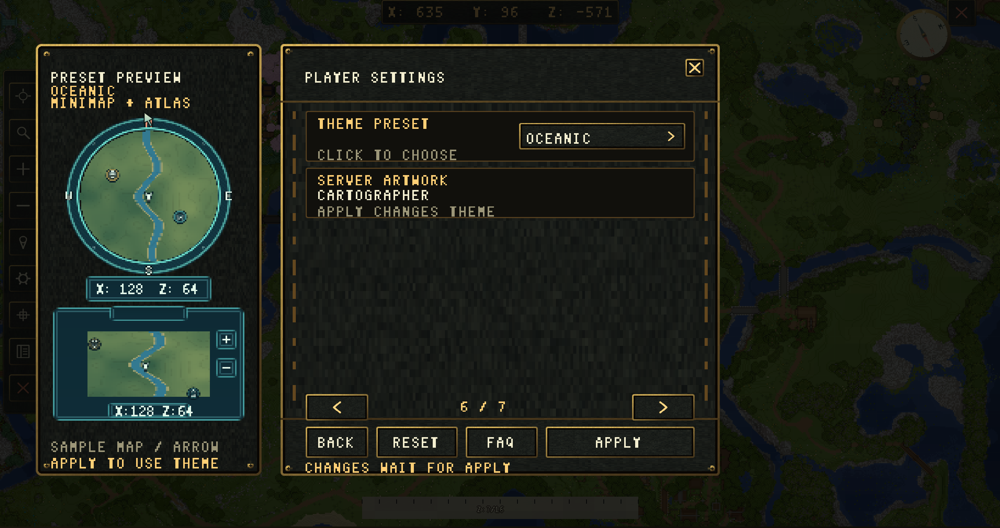

# Map Themes and Custom Artwork

Each complete client resource pack includes all seven built-in themes. Players can preview a theme in Map Settings, then Apply it without another download or resource-pack reload. The choice affects their interface; other players retain their choices.

| ID | Theme |
| --- | --- |
| `cartographer` | Original timber, brass and dark chart surfaces; default |
| `futuristic` | Graphite panels and cyan instruments |
| `vanilla` | Minecraft-style stone, timber and green accents |
| `medieval` | Leather, parchment, iron and warm gold |
| `minimal_dark` | Flat charcoal panels with restrained borders |
| `cartoony` | Bold outlines, indigo panels and mint accents |
| `oceanic` | Navy, sea-glass and nautical details |

**Server default** inherits the administrator's active theme and artwork overrides. Selecting a named built-in theme explicitly uses that preset instead.



*The theme preview shows the proposed minimap and atlas artwork before it is applied.*

## Server Default Theme

```yaml
Gui:
  Theme: cartographer
  ArtworkOverrides: true
```

Administrators can inspect or save a selection:

```text
/beastminimap theme list
/beastminimap theme status
/beastminimap theme set medieval
/beastminimap reload
```

Status distinguishes the saved configuration from the active prepared pack. Use reload to apply server artwork/preparation changes. Players accept updated pack content when that content changes. An ordinary player's Apply between already installed themes does not rebuild or reload the pack.

## Add a Custom Theme

Start from one of the optional [editable theme examples](https://github.com/MrAxeTv/BeastMiniMap#editable-theme-examples). These are authoring inputs, not the complete client ZIPs installed in `Packs/`.

Place the definition and artwork under the plugin's data folder:

```text
plugins/BeastMiniMap/Themes/Forest/
  Theme.yml
  Artwork/
    assets/beastminimap/textures/gui/...
```

Example `Theme.yml`:

```yaml
Enabled: true
Id: forest
Name: Forest
Description: Moss, timber and green map instruments
BasedOn: medieval
```

Keep `Id` unique and stable; it is saved in player preferences. IDs use lowercase letters, digits, underscores or hyphens. `BasedOn` selects one built-in palette and supplies unchanged artwork. Up to eight enabled custom themes can join the shared pack.

Edit the source master PNGs while preserving their expected image paths and dimensions. Follow the complete pack's `AUTHORING.md`. Custom themes cannot replace shaders, font definitions or protocol metadata. Do not use generated `gui/carriers` images as theme inputs.

Run `/beastminimap reload` after adding or editing artwork. Players must accept the changed shared pack. Once included, selecting the custom theme needs no further pack reload.

On 26.3, editable minimap HUD art is used directly. Earlier clients retain procedural minimap instruments using the selected base palette; their bitmap menus and atlas artwork still use the theme.

The `custom` theme ID is reserved for the separate administrator-owned, version-matched artwork override policy. Use an ordinary unique ID such as `forest` for an additional selectable theme.
