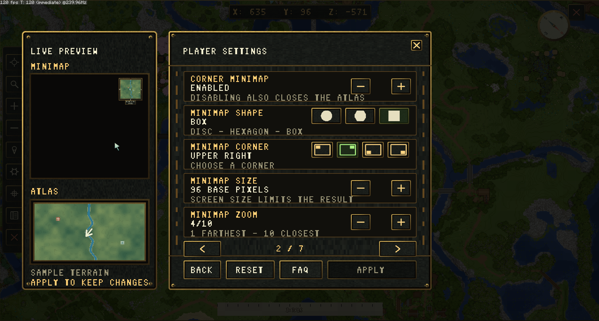

# Common Setup Flow

Use this checklist after [first installation](first-install.md). It separates basic access and delivery from optional map customization.

## 1. Verify access and delivery first

Run:

```text
/beastminimap pack info
```

Confirm that the client's matching pack is installed and that the advertised download address is reachable from the player's network. Accept the offered resource pack before testing the map. Resolve missing-file or download errors before tuning terrain quality.

Grant normal player roles the actions they should use. For a quick complete player-control setup:

```text
/lp group default permission set beastminimap.use true
/lp group default permission set beastminimap.buttons.* true
/lp group default permission set beastminimap.settings.* true
```

Then choose a personal waypoint allowance, for example:

```text
/lp group default permission set beastminimap.waypoints.limit.16 true
/lp group vip permission set beastminimap.waypoints.limit.128 true
```

A VIP inheriting the default group receives the higher true numeric limit, 128. See [permissions](../permissions.md) for selective grants and unlimited access.

## 2. Choose each world's terrain source

For a normal surface map:

```text
/beastminimap world source live_terrain world
```

For surface and cave layers:

```text
/beastminimap world source live_strata world
```

Replace `world` with the exact world name. Live sources use already-loaded chunks and reveal terrain through player discovery. A `world_texture` source uses an administrator-rendered saved image instead; follow [world-image rendering](../terrain/world-images.md) before selecting that setup.

## 3. Choose server defaults

Edit the initial minimap shape, corner and zoom in `config.yml`, then reload. These defaults do not overwrite returning players' saved preferences.

Keep `Atlas.SearchInput: anvil` for vanilla text entry. Choose `Atlas.MenuUi: pixel` for the map's styled menus or `native` for Minecraft's native dialogs and broader script support.

## 4. Select the language

Set the server-wide `Options.Language.Settings.File` value in `config.yml`, for example:

```yaml
Options:
  Language:
    Settings:
      File: en-US.yml
      AutoDownload: true
```

There are 33 bundled locales and 17 optional official downloads. Optional language downloading is separate from resource-pack installation: pack ZIPs still need to be installed manually. Existing custom language text is preserved when missing defaults are added.

## 5. Check the player experience

Using an ordinary player account:

1. Open `/beastminimap` and pan/zoom the atlas.
2. Open `/beastminimap map settings` and try the options the role may change.
3. Choose independent player icons for the minimap and atlas.
4. Create a personal waypoint and check the role's limit.
5. Close the atlas and walk through a loaded area to check the minimap and exploration.

The atlas does not open while the player is gliding with elytra-style flight. Starting to glide while it is open closes the atlas.



*The pixel settings menu previews the selected minimap appearance before Apply.*

## 6. Add shared destinations

An administrator with `beastminimap.places.admin` can add public places. Personal waypoints and shared places are separate: players own their waypoints, while administrators manage public destinations. See [administrator commands](../commands/admin-commands.md).

## 7. Keep a recoverable setup

Back up configuration, custom artwork, SQL data and saved map assets together. Test a restored backup before relying on it. Do not delete discoveries, the database selection record or a saved database to fix a visual or pack problem. See [storage](../storage.md) and [common issues](../troubleshooting/common-issues.md).
