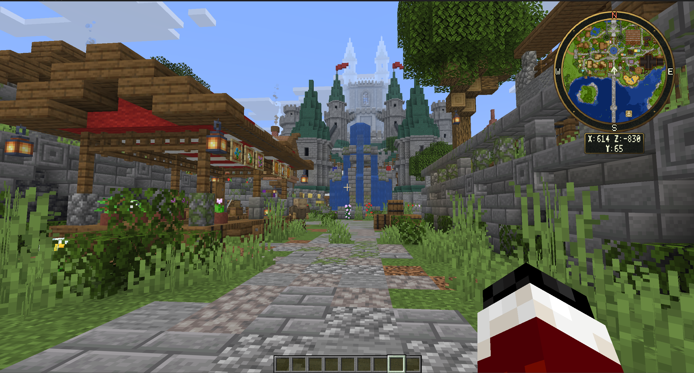

# First Install

BeastMiniMap gives players a corner minimap and an interactive fullscreen or framed atlas. Players use the server's resource pack; no client mod is required for normal map controls.

## Requirements

| Component | Requirement |
| --- | --- |
| Server | Paper or Spigot, Minecraft 1.21.9 through 26.3 |
| Dependency | [BeastLib 1.7.3 or newer](https://modrinth.com/plugin/beastlib) |
| Java | Java 21 or newer for supported 1.21.x servers; 26.x servers require Java 25 or newer |
| Client assets | A matching complete BeastMiniMap resource-pack ZIP for each supported client version |

The same plugin JAR uses Java 21 bytecode. The Minecraft server itself still determines which Java runtime it needs.

## Install the plugins and assets

1. Place the normal runtime `BeastLib.jar` and `BeastMiniMap.jar` in the server's `plugins/` folder.
2. Create `plugins/BeastMiniMap/Packs/` if it does not exist.
3. Download the complete pack matching your players' client version from the [official resource-pack releases](https://github.com/MrAxeTv/BeastMiniMap/releases).
4. Put the original ZIP in `Packs/`. Keep its filename and leave it zipped. Each complete ZIP already contains all seven built-in themes.
5. Start or restart the server normally. Review startup messages for missing packs or dependency errors.

For a server accepting only 26.3 clients, the relevant files look like this:

```text
plugins/
  BeastLib.jar
  BeastMiniMap.jar
  BeastMiniMap/
    Packs/
      BeastMiniMap-26.3.zip
```

The plugin JAR contains no pack ZIPs or artwork images. Installing the JAR alone does not install the resource pack, and the plugin does not download pack assets automatically.

See [pack installation](../resource-packs/installation.md) for all five client-version filenames.

## Make the pack reachable

The built-in pack host listens on TCP port `8862` by default. Remote players need a public address they can reach; `localhost` only points to the player's own computer.

Configure `Pack.Host` and `Pack.PublicUrl` in `config.yml`, then follow the [hosting guide](../resource-packs/hosting.md). On a managed host, use the additional TCP port assigned by the host.

## Grant player access

The default configuration requires explicit permissions for map controls and settings. Operators receive the declared wildcard permissions automatically. For a normal player group using LuckPerms:

```text
/lp group default permission set beastminimap.use true
/lp group default permission set beastminimap.buttons.* true
/lp group default permission set beastminimap.settings.* true
/lp group default permission set beastminimap.waypoints.limit.16 true
```

This example allows all player controls and settings, with up to 16 personal waypoints across all worlds. Grant individual actions instead when a role should have fewer controls. See the [permission guide](../permissions.md).

## Test as a player

1. Join and accept the offered BeastMiniMap pack.
2. Run `/beastminimap` to open the fullscreen atlas.
3. Run `/beastminimap map settings` to check the player settings menu.
4. Close the atlas and verify the corner minimap. `/beastminimap on` enables it if the saved player preference is off.
5. Test with an ordinary player account as well as an operator account, so wildcard operator access does not hide a missing group grant.

Explore a nearby loaded area to reveal live terrain. Saved-image rendering and player discovery are separate features; rendering an image does not grant exploration to every player.



*Example of the minimap and coordinate panel after accepting the resource pack.*

Next: [Common Setup Flow](common-setup-flow.md).
