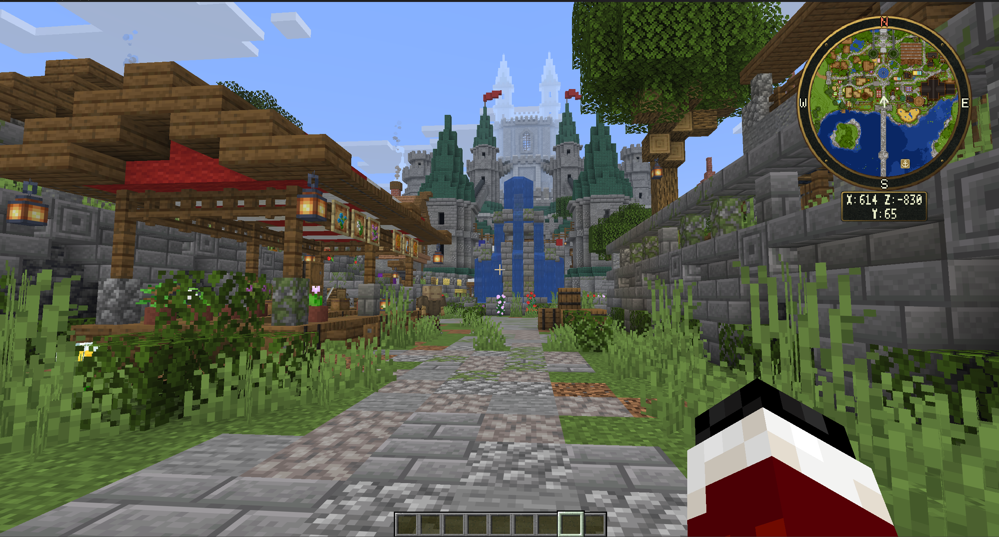

# Image Placement Guide

Use real gameplay screenshots to show the map's appearance and controls. Keep the existing wiki text usable while images are being prepared.

Store new images under `docs/gitbook/assets/images/`. Use PNG for interface screenshots, keep text readable at the page's normal width, and remove private chat, addresses, or player information before publishing.

## Screenshot checklist

| Suggested filename | Page | What to capture |
| --- | --- | --- |
| `01-minimap-overview.png` | Welcome and Minimap | Normal gameplay with the minimap, compass, player icon, and coordinate panel visible. |
| `02-minimap-shapes-and-corners.png` | Minimap | The same location shown with disc, hexagon, and box shapes in different corners; label the examples. |
| `03-fullscreen-atlas.png` | Atlas | The entire fullscreen map, left toolbar, player marker, compass, and horizontal coordinates. |
| `04-framed-atlas.png` | Atlas | The framed layout showing its border, title, and stacked coordinate readout. |
| `05-center-point.png` | Atlas | Center point enabled after panning away from the player, with center X/Z visible. |
| `06-personal-waypoints.png` | Waypoints and Places | A waypoint journal with a few clearly named personal locations and its controls. |
| `07-server-place-search.png` | Waypoints and Places | The server-place search and a selected public destination. |
| `08-cave-layers.png` | Live Terrain and Caves | Surface and cave views from the same region, labelled with the selected mode. |
| `09-world-image.png` | Saved World Images | A saved world image in the atlas, with enough landmarks to show its rendered area. |
| `10-player-marker-settings.png` | Player Settings | Separate minimap and atlas icon selectors and their previews. |
| `11-theme-selector.png` | Themes | The theme selector and a preview before Apply. |
| `12-keybind-settings.png` | Opening Keybinds | The modifier and trigger selectors with a readable selected gesture. |
| `13-permission-denied.png` | Permissions | A denied action and its translated feedback; do not include permission-manager account details. |
| `14-pack-folder.png` | Pack Installation | Only the installed complete pack filenames inside the plugin's Packs folder. |

## Add an image

For a page in a folder such as `maps/`, use:

```markdown

```

From the wiki home page, use:

```markdown

```

Only add the image link after its file exists. Replace the corresponding screenshot note with the image and a short caption. Use descriptive alt text.

## Existing listing images

These hosted images are already used in the owner's marketplace description. They can be reused while new local wiki screenshots are being prepared. Their grouped labels describe their current listing sections; review a screenshot before using it to illustrate a recently changed control.

| Listing section | Existing image |
| --- | --- |
| Product banner | [Banner](https://i.imgur.com/QzVBowH.png) |
| Overview | [Overview image](https://i.imgur.com/4YgEbIA.png) |
| Minimap layouts | [Layout examples](https://i.imgur.com/AoAZUsw.png) |
| Atlas | [Atlas image](https://i.imgur.com/UHhNUQp.png) |
| Waypoints and places | [First image](https://i.imgur.com/XGAcYtk.png), [second image](https://i.imgur.com/HqYb0zS.png) |
| Surface and cave layers | [First image](https://i.imgur.com/9xKIYhY.png), [second image](https://i.imgur.com/k2Eu2yo.png) |
| Terrain sources | [Terrain image](https://i.imgur.com/obNIQCs.png) |
| Settings and themes | [First image](https://i.imgur.com/F3iIiKy.png), [second image](https://i.imgur.com/lEYhL1e.png), [third image](https://i.imgur.com/DAXalMh.png) |
