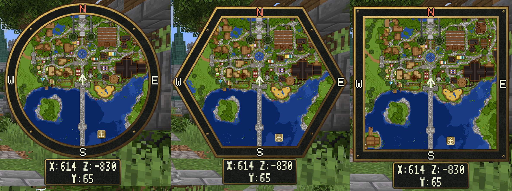

# Corner Minimap

The minimap follows your position while you play. It shows terrain you have discovered, your position marker, and permitted waypoint or public-place markers. It continues working while you fly or glide; the separate interactive atlas has different movement rules.

Players must accept the server's matching resource pack. See [resource-pack installation](../resource-packs/installation.md).

## Show, Hide and Zoom

```text
/beastminimap on
/beastminimap off
/beastminimap zoom 7
```

The minimap has ten zoom levels. Level 1 is farthest out; level 10 is closest. Use `zoom in`, `zoom out` or `zoom reset` as alternatives to a number.

`/map` is a configurable alias of the entire root command. With the default aliases, `/map zoom 7` also changes the **minimap**. Use `/beastminimap map zoom 7` for the atlas.

## Shape and Position

Open `/beastminimap map settings`, then choose the minimap options. The visual previews show the draft shape, size and screen corner before you apply it.

| Option | Choices |
| --- | --- |
| Shape | `disc`, `hexagon`, `box` |
| Corner | `upper_left`, `upper_right`, `lower_left`, `lower_right` |
| Base size | 64–256; the HUD scales and fits the viewport |
| Player symbol | Eleven shapes, independent of the full-map symbol |
| Player-symbol size | 0.5x–3x, independent of other markers |

The coordinate panel can be hidden. Its automatic width follows the displayed coordinates; fixed width keeps the panel steady. These controls are on the settings menu's Appearance page.



*The three minimap outlines using the Cartographer artwork.*

## Server Defaults

These values in `config.yml` apply when a player has no saved choice:

```yaml
Hud:
  EnabledByDefault: true
  DefaultZoom: x7
  Shape: disc
  Corner: upper_right
  Size: 96
  PlayerMarkerShape: arrow
  PlayerMarkerScale: 1.0
  Coordinates: true
  AutoFitCoordinatePanel: true
```

Configuration zoom values use identifiers such as `x7`; commands use plain numbers such as `7`. Reloading new server defaults preserves existing player preferences. See [player settings](../customization/player-settings.md).

Changing minimap visibility, shape, corner, size or zoom requires that setting's [permission](../permissions.md). These grants control which options players can change; a quota grant alone does not unlock a button.
