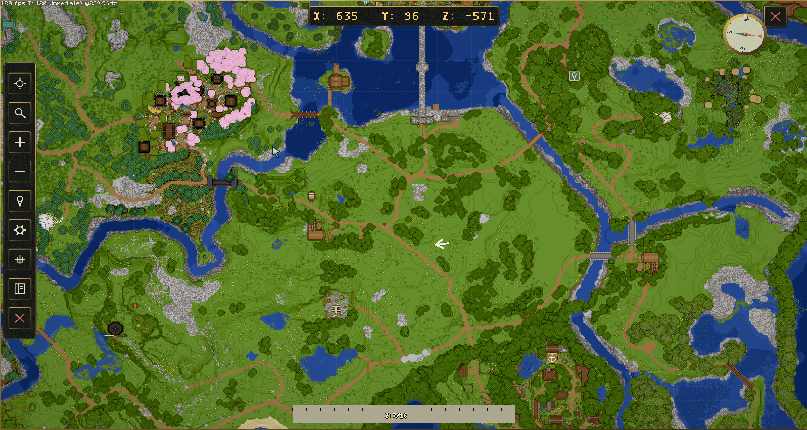
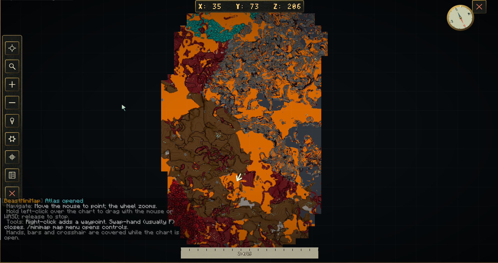

# Terrain sources

Choose how each world supplies its minimap and atlas terrain. The interface,
player settings, waypoints and navigation controls work with all three sources.

| `TerrainSource` | What players see | Best starting point |
| --- | --- | --- |
| `live_terrain` | Surface terrain collected from already-loaded chunks | Survival exploration |
| `live_strata` | Live surface terrain plus height-based cave layers | Servers that want underground mapping |
| `world_texture` | A saved world image rendered from existing region files | A fixed map of a selected area |



*Surface terrain and landmarks in the atlas interface.*



*An atlas terrain example from the Nether.*

New worlds use `live_terrain`. An administrator can change a loaded world with:

```text
/beastminimap world source live_strata world
/beastminimap world status world
```

Replace `world` with its exact loaded name. Players can omit the world to use
their current one; console must supply it. These commands require
`beastminimap.admin` and save the source choice in `worlds.yml`.

## Configure worlds

Edit the existing `Defaults` and `Worlds` sections in `worlds.yml`; do not add
duplicate sections. Exact world entries override the defaults.

```yaml
Defaults:
  TerrainSource: live_terrain
  RenderOnLoad: false
Worlds:
  world:
    TerrainSource: live_strata
  creative.world:
    TerrainSource: world_texture
    RenderSizeBlocks: 4096
```

World names are literal, including dots. After file edits, run
`/beastminimap reload`. Selecting `world_texture` does not itself force an image
rebuild; if no image is ready, live terrain remains available until one is
prepared. Follow [saved world images](world-images.md) to render it.

## Rendering, preparation and discovery

These operations serve different purposes:

| Operation | Result |
| --- | --- |
| Exploring with a live map | Records terrain around loaded chunks and the player's discovered area |
| `/beastminimap world prerender world` | Prepares reusable live-terrain source data from existing saved chunks |
| `/beastminimap world render world` | Produces a saved RGB world image for `world_texture` |

Neither administrative command generates missing Minecraft chunks or marks an
area as discovered by every player. A prepared terrain cache and a player's
exploration record are separate. With discovery enabled, shared live terrain is
still restricted to that player's revealed area.

Live mapping does not load or generate world chunks just to fill the map. Saved
image rendering and source preparation read existing region files. Terrain that
has never been saved cannot appear through those read-only jobs.

## Plant filtering

Plant filtering belongs in `worlds.yml`. The default hides only the listed grass
blocks; it does not remove all vegetation.

```yaml
Terrain:
  HidePlants: true
  HiddenPlants: [short_grass, tall_grass]
Worlds:
  creative.world:
    Terrain:
      HidePlants: false
```

Merge the world entry into your existing `Worlds` section. Reload applies edited
settings; rebuild an existing saved world image when you want those changes
painted into it.

Continue with [live terrain and caves](live-and-caves.md),
[saved world images](world-images.md), or the
[administrator command reference](../commands/admin-commands.md).
